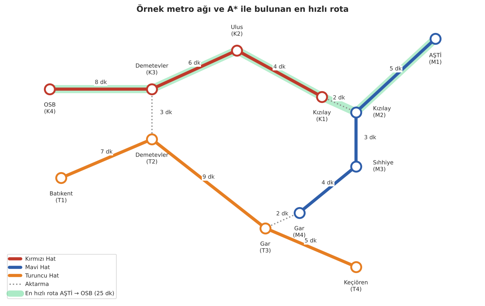

# Metro Ağı Simülasyonu

Bu projede bir metro ağını graf olarak modelleyip iki istasyon arasında en az duraklı ve en hızlı rotayı bulan küçük bir Python uygulaması yazdım. Örnek ağı Ankara metrosundan esinlenerek kurdum: üç hat (Kırmızı, Mavi, Turuncu), on iki istasyon ve Kızılay, Demetevler ve Gar'da üç aktarma noktası var. İstasyonlar arası süreler gerçek değil, algoritmaları denemek için seçtiğim dakika değerleri.

Kod yalnızca Python standart kütüphanesini (`collections`, `heapq`, `typing`) kullanıyor.



## Yaklaşım

Her istasyon `Istasyon` nesnesi, ağın tamamı da `MetroAgi` sınıfı. Aynı istasyonun farklı hatlardaki karşılıklarını ayrı düğüm olarak tuttum ve aralarına aktarma süresi kadar ağırlıklı bir kenar ekledim. Bu yüzden çıktıda "Kızılay -> Kızılay" gibi tekrarlar görünüyor; bunlar hat değiştirilen yerler.

- En az duraklı rota için BFS kullandım. Ağırlıksız grafta hedefe ilk ulaşılan yol en az kenarlı yol oluyor. Karmaşıklık O(V + E).
- En hızlı rota için `heapq` ile öncelikli kuyruk kullanan bir A* yazdım. Sezgisel fonksiyon şu an sabit (1) döndürüyor, yani algoritma pratikte Dijkstra gibi çalışıyor ve en kısa süreyi yine garanti ediyor.
- Boş istasyon bilgisi, negatif süre ve tanımsız istasyon kimliği için hata fırlatan basit kontroller ekledim.

## Sonuçlar

Dosyadaki üç test senaryosunun çıktısı:

```text
1. AŞTİ'den OSB'ye:
En az aktarmalı rota: AŞTİ -> Kızılay -> Kızılay -> Ulus -> Demetevler -> OSB
En hızlı rota (25 dakika): AŞTİ -> Kızılay -> Kızılay -> Ulus -> Demetevler -> OSB

2. Batıkent'ten Keçiören'e:
En az aktarmalı rota: Batıkent -> Demetevler -> Gar -> Keçiören
En hızlı rota (21 dakika): Batıkent -> Demetevler -> Gar -> Keçiören

3. Keçiören'den AŞTİ'ye:
En az aktarmalı rota: Keçiören -> Gar -> Gar -> Sıhhiye -> Kızılay -> AŞTİ
En hızlı rota (19 dakika): Keçiören -> Gar -> Gar -> Sıhhiye -> Kızılay -> AŞTİ
```

Bu küçük ağda iki yöntem her senaryoda aynı rotayı buldu. Bu beklenen bir durum, çünkü alternatif güzergâh sayısı az. Daha sık örülmüş bir ağda iki yöntemin ayrışmasını beklerim.

Benim için en öğretici kısım, fonksiyonun adı ile yaptığı iş arasındaki farkı görmek oldu: adı `en_az_aktarma_bul` ama BFS aslında en az durağı buluyor, aktarma sayısını doğrudan en aza indirmiyor. Aktarma kenarları da birer adım sayıldığı için bu ağda ikisi örtüşüyor, genel durumda örtüşmek zorunda değil.

## Çalıştırmak için

```bash
git clone https://github.com/Memreu/Metro-Network-Simulation.git
cd Metro-Network-Simulation
python metro_simulation.py
```

Ağ görselini yeniden üretmek isterseniz `pip install -r requirements.txt` ile matplotlib'i kurup `python scripts/readme_grafikleri.py` çalıştırabilirsiniz.

Kendi ağınızı da kurabilirsiniz:

```python
from metro_simulation import MetroAgi

metro = MetroAgi()
metro.istasyon_ekle("A1", "Merkez", "Yeşil Hat")
metro.istasyon_ekle("A2", "Üniversite", "Yeşil Hat")
metro.baglanti_ekle("A1", "A2", 6)

rota, sure = metro.en_hizli_rota_bul("A1", "A2")
print(" -> ".join(i.ad for i in rota), f"({sure} dk)")
```

## Eksikler

Gerçek anlamda en az aktarmayı bulmak için durumu (istasyon, hat) çifti olarak tutan bir 0-1 BFS gerekiyor; A* için de istasyon koordinatlarıyla anlamlı bir sezgisel tanımlamak istiyorum. Test senaryolarını `pytest` ile birim testlerine çevirmek de listede.

MIT lisansı ile paylaşılmıştır.
