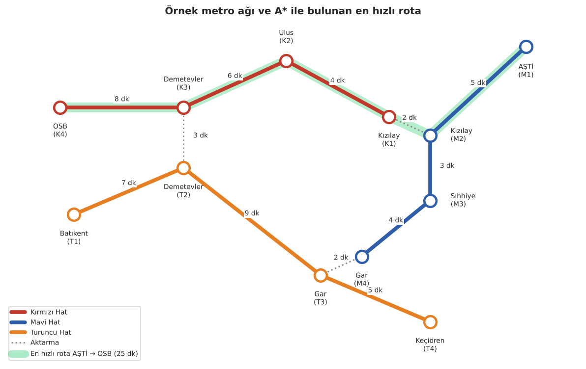
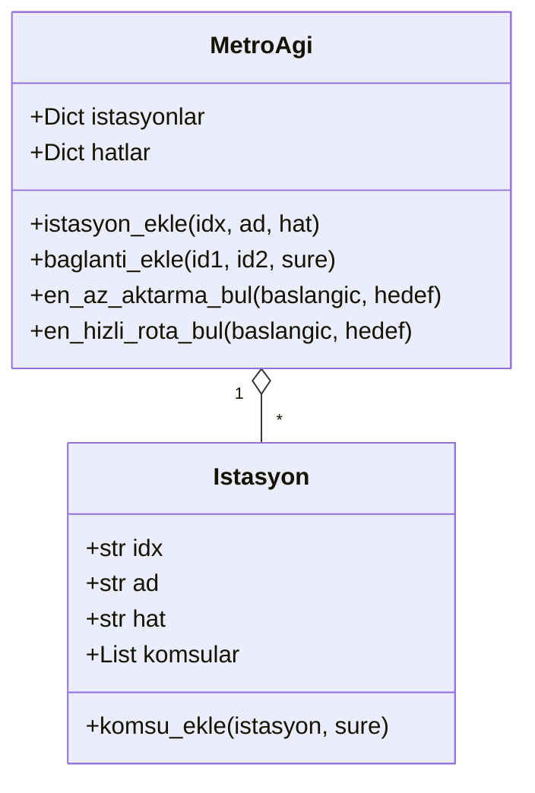

# 🚇 Metro Ağı Simülasyonu: BFS ve A* ile Rota Bulma

<p align="center">
  
  
  
  
</p>

Bir metro ağını **graf** olarak modelleyen ve iki istasyon arasında **en az duraklı** (BFS) ve **en hızlı** (A*) rotayı bulan nesne yönelimli bir Python uygulaması. Ankara metrosundan esinlenen örnek ağ üç hat, on iki istasyon ve üç aktarma noktasından oluşuyor.

<p align="center"></p>

> 🇬🇧 **In English:** An object-oriented Python simulation of a metro network modelled as a weighted graph. Breadth-first search finds the route with the fewest stops and A* (with a priority queue) finds the fastest route in minutes, including transfer times between lines. The project uses only the Python standard library (`collections`, `heapq`, `typing`) and includes input validation and three test scenarios on a sample network inspired by the Ankara metro.

<details>
<summary><b>📑 İçindekiler</b></summary>

- [Özellikler](#özellikler)
- [Örnek çıktı](#örnek-çıktı)
- [Algoritmalar](#algoritmalar)
- [Kod yapısı](#kod-yapısı)
- [Kurulum ve çalıştırma](#kurulum-ve-çalıştırma)
- [Kendi ağını oluşturma](#kendi-ağını-oluşturma)
- [Sınırlılıklar ve geliştirme fikirleri](#sınırlılıklar-ve-geliştirme-fikirleri)

</details>

## Özellikler

| | |
|---|---|
| 🧭 **En az duraklı rota** | BFS ile, en az istasyondan geçen güzergâh |
| ⚡ **En hızlı rota** | A* ve öncelikli kuyruk (`heapq`) ile toplam süresi en kısa güzergâh |
| 🔁 **Aktarmalar** | Aynı istasyonun farklı hatlardaki karşılıkları, aktarma süresiyle bağlanır |
| 🛡️ **Girdi doğrulama** | Boş istasyon bilgisi, negatif süre ve tanımsız istasyon için anlamlı hata mesajları |
| 🧩 **Bağımlılıksız** | Yalnızca Python standart kütüphanesi; tip ipuçları (`typing`) ve docstring'lerle belgelenmiş |

## Örnek çıktı

```text
=== Test Senaryoları ===

1. AŞTİ'den OSB'ye:
En az aktarmalı rota: AŞTİ -> Kızılay -> Kızılay -> Ulus -> Demetevler -> OSB
En hızlı rota (25 dakika): AŞTİ -> Kızılay -> Kızılay -> Ulus -> Demetevler -> OSB

2. Batıkent'ten Keçiören'e:
En az aktarmalı rota: Batıkent -> Demetevler -> Gar -> Keçiören
En hızlı rota (21 dakika): Batıkent -> Demetevler -> Gar -> Keçiören

3. Keçiören'den AŞTİ'ye:
En az aktarmalı rota: Keçiören -> Gar -> Gar -> Sıhhiye -> Kızılay -> AŞTİ
En hızlı rota (19 dakika): Keçiören -> Gar -> Gar -> Sıhhiye -> Kızılay -> AŞTİ
```

Rotada art arda iki kez geçen istasyonlar (ör. *Kızılay → Kızılay*) hat değiştirilen aktarma noktalarıdır.

## Algoritmalar

### 1. BFS (Genişlik Öncelikli Arama): en az duraklı rota

- Başlangıç istasyonundan başlar, önce tüm komşuları, sonra onların komşularını ziyaret eder (`collections.deque` ile FIFO kuyruk).
- Ziyaret edilen istasyonlar bir kümede tutulur, böylece döngüye girilmez.
- Hedefe ilk ulaşıldığı anda bulunan rota, **en az kenardan (durak/aktarma adımından)** oluşan rotadır.
- Karmaşıklık: **O(V + E)**

### 2. A* Algoritması: en hızlı rota

- Her adımda `g(n) + h(n)` değeri en küçük olan rota genişletilir; `g(n)` o ana kadarki toplam süre, `h(n)` hedefe kalan tahmini süredir.
- Öncelikli kuyruk olarak `heapq` (min-heap) kullanılır.
- Bu uygulamada `h(n)` sabit bir değerdir; bu nedenle algoritma pratikte **Dijkstra** gibi davranır ve en kısa süreli rotayı garanti eder.
- Karmaşıklık: **O((V + E) log V)**

### Neden bu algoritmalar?

| İhtiyaç | Algoritma | Neden |
|---|---|---|
| En az durak | BFS | Ağırlıksız grafta en kısa yolu katman katman tarayarak garanti eder |
| En kısa süre | A* / Dijkstra | Ağırlıklı (dakika) grafta en kısa yolu bulur; iyi bir sezgisel fonksiyonla aramayı hızlandırabilir |

## Kod yapısı



## Kurulum ve çalıştırma

```bash
git clone https://github.com/Memreu/Metro-Network-Simulation.git
cd Metro-Network-Simulation
python metro_simulation.py
```

Ek bir paket gerekmez. README'deki ağ görselini yeniden üretmek için:

```bash
pip install -r requirements.txt
python scripts/readme_grafikleri.py
```

## Kendi ağını oluşturma

```python
from metro_simulation import MetroAgi

metro = MetroAgi()
metro.istasyon_ekle("A1", "Merkez", "Yeşil Hat")
metro.istasyon_ekle("A2", "Üniversite", "Yeşil Hat")
metro.baglanti_ekle("A1", "A2", 6)   # 6 dakika

rota, sure = metro.en_hizli_rota_bul("A1", "A2")
print(" -> ".join(i.ad for i in rota), f"({sure} dk)")
```

## Klasör yapısı

```
├── metro_simulation.py           # İstasyon / MetroAgi sınıfları, algoritmalar ve test senaryoları
├── scripts/
│   └── readme_grafikleri.py      # Ağ görselini üreten betik
├── images/                       # README görselleri
├── requirements.txt              # Yalnızca görsel betiği için (matplotlib)
├── LICENSE
└── README.md
```

## Sınırlılıklar ve geliştirme fikirleri

- **Gerçek "en az aktarma".** BFS şu an en az durağı buluyor; aktarma sayısını doğrudan en aza indirmek için durumun *(istasyon, hat)* çifti olarak tutulduğu ve yalnızca hat değişiminin maliyetlendirildiği bir arama (ör. 0-1 BFS) gerekir.
- **Anlamlı bir sezgisel fonksiyon.** İstasyon koordinatları eklenerek A* için kuş uçuşu mesafe / maksimum hız gibi kabul edilebilir (admissible) bir sezgisel tanımlanabilir.
- **Görselleştirme.** Bulunan rotanın harita üzerinde çizilmesi (matplotlib / networkx).
- **Çok modlu ulaşım ve ücret.** Otobüs ve metrobüs hatlarının eklenmesi, kullanıcı tipine göre (öğrenci, tam) yolculuk ücretinin hesaplanması.
- **Testler.** Senaryoların `pytest` ile birim testlerine dönüştürülmesi.

---

Bu proje [MIT lisansı](LICENSE) ile paylaşılmaktadır.

**Mehmet Emre Ünlü** · [GitHub](https://github.com/Memreu) · [LinkedIn](https://www.linkedin.com/in/memreu) · [Kaggle](https://www.kaggle.com/memreu)
